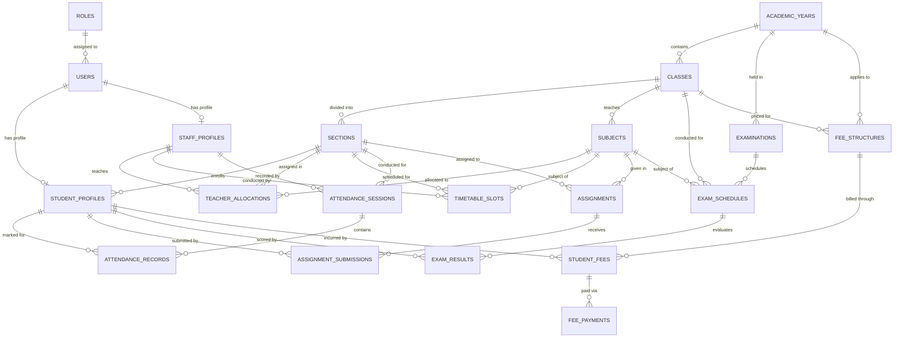

# Database Design Specification & Entity-Relationship Architecture
## NEXORA: Enterprise Education Resource Planning (ERP) System

---

### Document Overview
- **Version**: 1.0.0
- **Database Engine**: PostgreSQL 16+ (Production) / SQLite 3.38+ (Local Development & CI)
- **Object Relational Mapper**: SQLAlchemy 2.0 (Declarative Dataclass-style mappings)
- **Migration Framework**: Alembic
- **Standard**: Third Normal Form (3NF) compliant relational model

---

## 1. Architectural Principles & Design Decisions

1. **Third Normal Form (3NF) Compliance**:
   - Transitive dependencies are eliminated. All non-key attributes are fully dependent on primary keys.
   - Prevents update, insertion, and deletion anomalies.

2. **Primary Key Strategy**:
   - Primary keys use 64-bit auto-incrementing integers (`BIGSERIAL` in PostgreSQL / `INTEGER PRIMARY KEY` in SQLite) for optimal indexing speed and foreign key join performance.
   - External-facing public identifiers (e.g., fee receipt numbers, student enrollment numbers) utilize unique, formatted alphanumeric strings to avoid sequential enumeration attacks.

3. **Temporal Tracking**:
   - All critical domain entities implement standard auditing timestamps: `created_at` (UTC timestamp) and `updated_at` (auto-updating UTC timestamp).

4. **Referential Integrity & Cascading Rules**:
   - **`ON DELETE CASCADE`**: Applied only to strictly dependent child entities (e.g., when an `attendance_session` is purged, its child `attendance_records` cascade-delete).
   - **`ON DELETE RESTRICT`**: Applied to critical academic and financial entities (e.g., a `class` cannot be deleted if active `student_profiles` reference it; a `fee_structure` cannot be deleted if linked `student_fees` exist).

---

## 2. Visual Entity-Relationship (ER) Diagram

---

## 3. Data Dictionary: Entity Specifications

### 3.1 Domain: Identity & Access Management (IAM)

#### Table: `roles`
Stores system permission roles.
| Column | Type | Constraints | Description |
| :--- | :--- | :--- | :--- |
| `id` | `BIGINT` | `PK`, `AUTO_INCREMENT` | Unique role identifier |
| `name` | `VARCHAR(32)` | `UNIQUE`, `NOT NULL` | Role name (`ADMIN`, `TEACHER`, `STUDENT`, `PARENT`) |
| `description` | `VARCHAR(255)` | `NULLABLE` | Human-readable role description |

#### Table: `users`
Central authentication ledger for all personas.
| Column | Type | Constraints | Description |
| :--- | :--- | :--- | :--- |
| `id` | `BIGINT` | `PK`, `AUTO_INCREMENT` | Unique user identity |
| `role_id` | `BIGINT` | `FK -> roles(id)`, `NOT NULL` | Associated permission role |
| `email` | `VARCHAR(128)` | `UNIQUE`, `NOT NULL` | Login email address |
| `hashed_password` | `VARCHAR(255)` | `NOT NULL` | Argon2/bcrypt password hash |
| `first_name` | `VARCHAR(64)` | `NOT NULL` | User's first name |
| `last_name` | `VARCHAR(64)` | `NOT NULL` | User's last name |
| `phone_number` | `VARCHAR(20)` | `NULLABLE` | Contact phone number |
| `is_active` | `BOOLEAN` | `DEFAULT TRUE`, `NOT NULL` | Account operational status |
| `created_at` | `TIMESTAMP` | `DEFAULT CURRENT_TIMESTAMP` | Account creation timestamp |
| `updated_at` | `TIMESTAMP` | `DEFAULT CURRENT_TIMESTAMP` | Last profile update timestamp |

---

### 3.2 Domain: Academic Hierarchy & Profiles

#### Table: `academic_years`
Institution operational calendar year.
| Column | Type | Constraints | Description |
| :--- | :--- | :--- | :--- |
| `id` | `BIGINT` | `PK`, `AUTO_INCREMENT` | Academic year identifier |
| `name` | `VARCHAR(32)` | `UNIQUE`, `NOT NULL` | Academic year label (e.g., `2026-2027`) |
| `start_date` | `DATE` | `NOT NULL` | Term start date |
| `end_date` | `DATE` | `NOT NULL` | Term completion date |
| `is_current` | `BOOLEAN` | `DEFAULT FALSE`, `NOT NULL` | Active academic year flag |

#### Table: `classes`
Grade / standard levels within the institution.
| Column | Type | Constraints | Description |
| :--- | :--- | :--- | :--- |
| `id` | `BIGINT` | `PK`, `AUTO_INCREMENT` | Class identifier |
| `academic_year_id`| `BIGINT` | `FK -> academic_years(id)`, `NOT NULL` | Academic calendar linkage |
| `name` | `VARCHAR(64)` | `NOT NULL` | Class title (e.g., `Grade 10`) |
| `numerical_level` | `INT` | `NOT NULL` | Order sequence (e.g., `10`) |

#### Table: `sections`
Class subdivisions for capacity management.
| Column | Type | Constraints | Description |
| :--- | :--- | :--- | :--- |
| `id` | `BIGINT` | `PK`, `AUTO_INCREMENT` | Section identifier |
| `class_id` | `BIGINT` | `FK -> classes(id)`, `NOT NULL` | Parent class reference |
| `name` | `VARCHAR(16)` | `NOT NULL` | Section label (e.g., `A`, `B`) |
| `room_number` | `VARCHAR(32)` | `NULLABLE` | Physical classroom designation |

#### Table: `subjects`
Curricular subjects taught within the class.
| Column | Type | Constraints | Description |
| :--- | :--- | :--- | :--- |
| `id` | `BIGINT` | `PK`, `AUTO_INCREMENT` | Subject identifier |
| `class_id` | `BIGINT` | `FK -> classes(id)`, `NOT NULL` | Applicable class grade |
| `name` | `VARCHAR(128)`| `NOT NULL` | Subject title (e.g., `Physics`) |
| `code` | `VARCHAR(32)` | `NOT NULL` | Subject course code (e.g., `PHY-101`) |

#### Table: `staff_profiles`
Faculty and administrative personnel records.
| Column | Type | Constraints | Description |
| :--- | :--- | :--- | :--- |
| `id` | `BIGINT` | `PK`, `AUTO_INCREMENT` | Staff record ID |
| `user_id` | `BIGINT` | `FK -> users(id)`, `UNIQUE`, `NOT NULL` | Associated authentication user |
| `employee_code` | `VARCHAR(32)` | `UNIQUE`, `NOT NULL` | Employee identifier (e.g., `EMP-1042`) |
| `department` | `VARCHAR(64)` | `NOT NULL` | Academic department |
| `qualification` | `VARCHAR(128)`| `NOT NULL` | Highest degree held |
| `date_of_joining`| `DATE` | `NOT NULL` | Onboarding date |

#### Table: `student_profiles`
Student demographic and academic registry.
| Column | Type | Constraints | Description |
| :--- | :--- | :--- | :--- |
| `id` | `BIGINT` | `PK`, `AUTO_INCREMENT` | Student record ID |
| `user_id` | `BIGINT` | `FK -> users(id)`, `UNIQUE`, `NOT NULL` | Associated authentication user |
| `section_id` | `BIGINT` | `FK -> sections(id)`, `NOT NULL` | Current enrolled section |
| `enrollment_number`| `VARCHAR(32)`| `UNIQUE`, `NOT NULL` | Roll / Admission number |
| `date_of_birth` | `DATE` | `NOT NULL` | Student birth date |
| `gender` | `VARCHAR(16)` | `NOT NULL` | `MALE`, `FEMALE`, `OTHER` |
| `guardian_name` | `VARCHAR(128)`| `NOT NULL` | Primary parent/guardian full name |
| `guardian_phone`| `VARCHAR(20)` | `NOT NULL` | Guardian emergency telephone |
| `address` | `TEXT` | `NULLABLE` | Residential address |

#### Table: `teacher_subject_allocations`
Cross-table assigning teachers to subjects within specific sections.
| Column | Type | Constraints | Description |
| :--- | :--- | :--- | :--- |
| `id` | `BIGINT` | `PK`, `AUTO_INCREMENT` | Allocation identifier |
| `staff_id` | `BIGINT` | `FK -> staff_profiles(id)`, `NOT NULL` | Assigned teacher |
| `subject_id` | `BIGINT` | `FK -> subjects(id)`, `NOT NULL` | Assigned subject |
| `section_id` | `BIGINT` | `FK -> sections(id)`, `NOT NULL` | Target class section |

---

### 3.3 Domain: Scheduling & Daily Attendance Operations

#### Table: `timetable_slots`
Weekly class period schedule.
| Column | Type | Constraints | Description |
| :--- | :--- | :--- | :--- |
| `id` | `BIGINT` | `PK`, `AUTO_INCREMENT` | Schedule slot identifier |
| `section_id` | `BIGINT` | `FK -> sections(id)`, `NOT NULL` | Class section |
| `subject_id` | `BIGINT` | `FK -> subjects(id)`, `NOT NULL` | Course subject |
| `staff_id` | `BIGINT` | `FK -> staff_profiles(id)`, `NOT NULL` | Instructor |
| `day_of_week` | `VARCHAR(16)` | `NOT NULL` | Day (`MONDAY` - `SATURDAY`) |
| `start_time` | `TIME` | `NOT NULL` | Period start time |
| `end_time` | `TIME` | `NOT NULL` | Period end time |
| `room_number` | `VARCHAR(32)` | `NULLABLE` | Assigned classroom |

#### Table: `attendance_sessions`
Daily attendance roll call instance for a class.
| Column | Type | Constraints | Description |
| :--- | :--- | :--- | :--- |
| `id` | `BIGINT` | `PK`, `AUTO_INCREMENT` | Session identifier |
| `section_id` | `BIGINT` | `FK -> sections(id)`, `NOT NULL` | Target section |
| `recorded_by_id` | `BIGINT` | `FK -> staff_profiles(id)`, `NOT NULL`| Teacher recording the roll |
| `date` | `DATE` | `NOT NULL` | Session date |
| `period_number` | `INT` | `DEFAULT 1`, `NOT NULL` | Period number (1 for daily roll) |
| `created_at` | `TIMESTAMP` | `DEFAULT CURRENT_TIMESTAMP` | System creation timestamp |

#### Table: `attendance_records`
Individual student attendance status per session.
| Column | Type | Constraints | Description |
| :--- | :--- | :--- | :--- |
| `id` | `BIGINT` | `PK`, `AUTO_INCREMENT` | Record identifier |
| `session_id` | `BIGINT` | `FK -> attendance_sessions(id) ON DELETE CASCADE`, `NOT NULL` | Parent roll call session |
| `student_id` | `BIGINT` | `FK -> student_profiles(id)`, `NOT NULL`| Evaluated student |
| `status` | `VARCHAR(16)` | `NOT NULL` | `PRESENT`, `ABSENT`, `LATE`, `EXCUSED` |
| `remarks` | `VARCHAR(255)` | `NULLABLE` | Teacher remarks/excuse reason |

---

### 3.4 Domain: Examinations & Evaluations

#### Table: `examinations`
Formal testing events (e.g., Mid-Term 2026, Annual Finals).
| Column | Type | Constraints | Description |
| :--- | :--- | :--- | :--- |
| `id` | `BIGINT` | `PK`, `AUTO_INCREMENT` | Exam identifier |
| `academic_year_id`| `BIGINT` | `FK -> academic_years(id)`, `NOT NULL` | Academic year linkage |
| `name` | `VARCHAR(128)`| `NOT NULL` | Examination name |
| `term` | `VARCHAR(32)` | `NOT NULL` | `TERM_1`, `TERM_2`, `ANNUAL` |

#### Table: `exam_schedules`
Specific date and time for an exam subject.
| Column | Type | Constraints | Description |
| :--- | :--- | :--- | :--- |
| `id` | `BIGINT` | `PK`, `AUTO_INCREMENT` | Schedule ID |
| `exam_id` | `BIGINT` | `FK -> examinations(id)`, `NOT NULL` | Parent exam series |
| `subject_id` | `BIGINT` | `FK -> subjects(id)`, `NOT NULL` | Exam subject |
| `class_id` | `BIGINT` | `FK -> classes(id)`, `NOT NULL` | Tested class level |
| `exam_date` | `DATE` | `NOT NULL` | Scheduled date |
| `start_time` | `TIME` | `NOT NULL` | Exam paper start time |
| `duration_minutes`| `INT` | `NOT NULL` | Test length in minutes |
| `maximum_marks` | `DECIMAL(5,2)`| `NOT NULL` | Maximum possible marks (e.g., 100.00) |
| `passing_marks` | `DECIMAL(5,2)`| `NOT NULL` | Minimum pass mark (e.g., 35.00) |

#### Table: `exam_results`
Student scores on scheduled examinations.
| Column | Type | Constraints | Description |
| :--- | :--- | :--- | :--- |
| `id` | `BIGINT` | `PK`, `AUTO_INCREMENT` | Result ID |
| `exam_schedule_id`| `BIGINT` | `FK -> exam_schedules(id)`, `NOT NULL` | Paper schedule |
| `student_id` | `BIGINT` | `FK -> student_profiles(id)`, `NOT NULL`| Tested student |
| `marks_obtained` | `DECIMAL(5,2)`| `NOT NULL` | Scored mark |
| `grade` | `VARCHAR(8)` | `NOT NULL` | Computed letter grade (`A+`, `A`, `B`, `F`) |
| `remarks` | `VARCHAR(255)` | `NULLABLE` | Evaluator notes |

---

### 3.5 Domain: Fee Management & Invoicing

#### Table: `fee_structures`
Institutional fee categories defined per class grade.
| Column | Type | Constraints | Description |
| :--- | :--- | :--- | :--- |
| `id` | `BIGINT` | `PK`, `AUTO_INCREMENT` | Fee structure ID |
| `academic_year_id`| `BIGINT` | `FK -> academic_years(id)`, `NOT NULL` | Academic calendar linkage |
| `class_id` | `BIGINT` | `FK -> classes(id)`, `NOT NULL` | Applicable class grade |
| `name` | `VARCHAR(128)`| `NOT NULL` | Fee label (e.g., `Tuition Term 1`) |
| `amount` | `DECIMAL(10,2)`| `NOT NULL` | Standard tariff amount |
| `due_date` | `DATE` | `NOT NULL` | Payment deadline |

#### Table: `student_fees`
Individual student fee billings and ledger status.
| Column | Type | Constraints | Description |
| :--- | :--- | :--- | :--- |
| `id` | `BIGINT` | `PK`, `AUTO_INCREMENT` | Billing invoice ID |
| `student_id` | `BIGINT` | `FK -> student_profiles(id)`, `NOT NULL`| Billed student |
| `fee_structure_id`| `BIGINT` | `FK -> fee_structures(id)`, `NOT NULL` | Assigned fee category |
| `discount_amount` | `DECIMAL(10,2)`| `DEFAULT 0.00`, `NOT NULL` | Scholarship/concession deduction |
| `net_amount` | `DECIMAL(10,2)`| `NOT NULL` | `amount - discount_amount` |
| `status` | `VARCHAR(16)` | `DEFAULT 'PENDING'`, `NOT NULL` | `PENDING`, `PARTIAL`, `PAID`, `OVERDUE` |

#### Table: `fee_payments`
Recorded financial transactions and receipts.
| Column | Type | Constraints | Description |
| :--- | :--- | :--- | :--- |
| `id` | `BIGINT` | `PK`, `AUTO_INCREMENT` | Payment transaction ID |
| `student_fee_id` | `BIGINT` | `FK -> student_fees(id)`, `NOT NULL` | Target bill item |
| `receipt_number` | `VARCHAR(32)` | `UNIQUE`, `NOT NULL` | Sequential receipt code (e.g., `REC-2026-0041`) |
| `amount_paid` | `DECIMAL(10,2)`| `NOT NULL` | Transacted monetary sum |
| `payment_method` | `VARCHAR(32)` | `NOT NULL` | `CASH`, `BANK_TRANSFER`, `ONLINE`, `CARD` |
| `transaction_reference`| `VARCHAR(64)` | `NULLABLE` | Bank UTR / Gateway reference |
| `payment_date` | `TIMESTAMP` | `DEFAULT CURRENT_TIMESTAMP` | Payment timestamp |

---

## 4. Indexing Strategy & Query Optimization

To maintain sub-150ms response times across web and mobile clients:
1. **`users(email)`**: Unique B-tree index for rapid credential verification during login.
2. **`student_profiles(enrollment_number)`**: Unique B-tree index for instant student lookups.
3. **`attendance_records(session_id, student_id)`**: Composite unique index preventing duplicate entries and speeding up class roster checks.
4. **`attendance_sessions(section_id, date)`**: Composite index for swift retrieval of class attendance calendars.
5. **`exam_results(student_id, exam_schedule_id)`**: Index for instant student report card compilation.
6. **`student_fees(student_id, status)`**: Index for quick dashboard calculation of pending dues.
